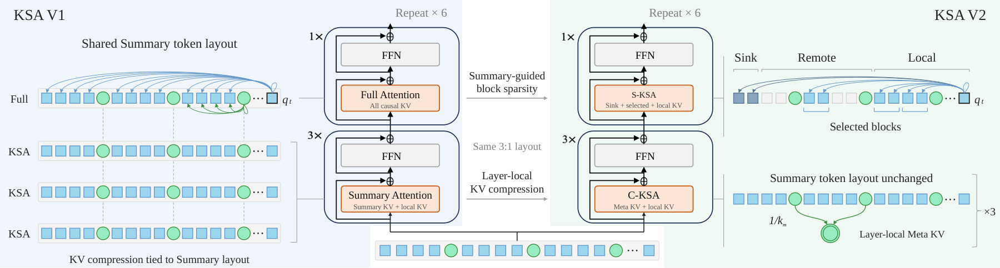
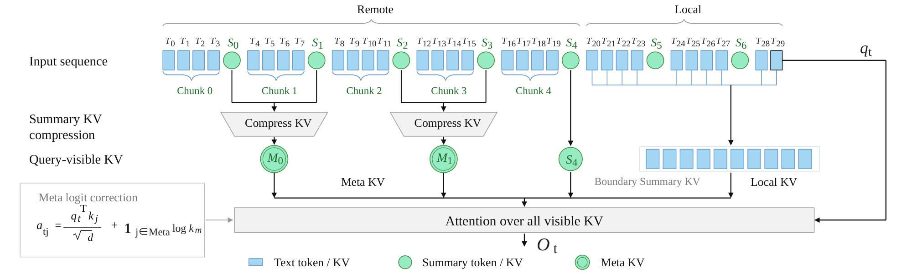
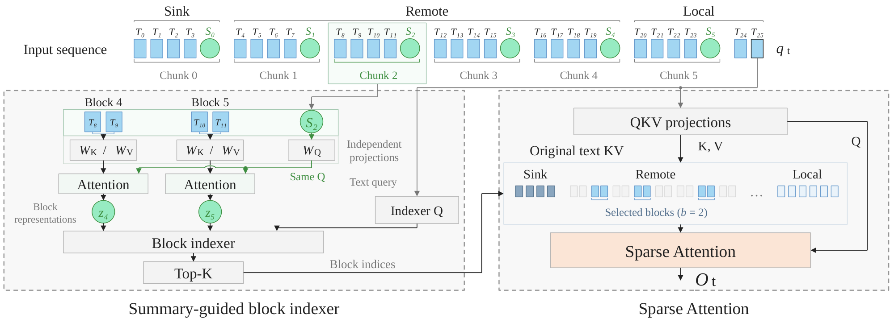
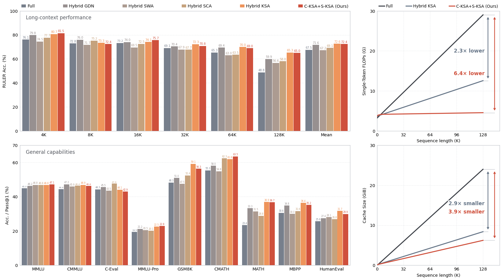

<div align="center">
  <h1>Kwai Summary Attention (KSA)</h1>
  <p><strong>Summary tokens as long-range memory and sparse indexes</strong></p>
  <p>
    <a href="https://arxiv.org/abs/2610.18654"></a>
    <a href="https://arxiv.org/abs/2604.24432"></a>
    <a href="https://github.com/Kuaishou-OneRec/KSA"></a>
    <a href="LICENSE"></a>
  </p>
  <p><a href="README.md">English</a> | <a href="README_zh.md">中文</a></p>
</div>

## 📖 Introduction

**Kwai Summary Attention (KSA)** is our attention architecture for efficient
long-context modeling. Learnable Summary tokens at fixed chunk boundaries
preserve a compressed representation of distant history.

**KSA V2** gives these Summaries two complementary roles:

- **Compressed KSA (C-KSA)** aggregates Summary KV into compact Meta KV for
  more efficient long-range memory.
- **Sparse KSA (S-KSA)** uses Summaries to build block-level routing keys.
  A lightweight Indexer selects relevant blocks, whose original KV is read
  directly by the main attention.

We retain Hybrid KSA's 3:1 layer layout, replacing KSA layers with C-KSA and
Full layers with S-KSA. This repository provides the **Muse training code,
attention kernels, training scripts, Hugging Face export and inference**
for both versions.

<p align="center"></p>
<p align="center"><em>From Hybrid KSA to KSA V2: shared Summaries, layer-local KV compression and sparse original-token access.</em></p>

## 🔥 News

- **2026-11-04** — KSA V2 1.9B / 4B and KSA V1 1.9B weights released in our [Hugging Face collection](https://huggingface.co/collections/OpenOneRec/ksa).
- **2026-10-13** — [KSA V2 technical report](https://arxiv.org/abs/2610.18654) released.
- **2026-05-08** — [KSA-4B-base](https://huggingface.co/OpenOneRec/KSA-4B-base) weights released.
- **2026-04-28** — [KSA technical report](https://arxiv.org/abs/2604.24432) and training code released.

## ✨ Method and training

**C-KSA: Summary → Meta KV.** Learnable dimension-wise pooling compresses groups
of Summary KV within each attention layer. Summary tokens continue through
the backbone at their original chunk granularity; stronger KV compression does
not require a new large-chunk backbone. Each query attends to remote Meta,
boundary Summary and local text KV. Meta entries remain local to the layer
that constructs them; they are not propagated as new tokens.

<p align="center"></p>
<p align="center"><em>C-KSA hierarchical compression, illustrated with chunk size 4 and two Summaries per Meta entry.</em></p>

**S-KSA: Summary → block index.** A Summary query aggregates each text block
into a representation for low-dimensional routing. Main attention reads the
selected blocks' original KV together with sinks and local context. A
blockwise-max dense-attention teacher supervises the Indexer.

<p align="center"></p>
<p align="center"><em>S-KSA block routing, illustrated with chunk size 4 and block size 2. Released model configurations are listed below.</em></p>

**Three adaptation stages.** Compression-module warmup → full-parameter C-KSA
CPT → S-KSA aggregation and Indexer warmup. The final stage freezes inherited
parameters; its checkpoint is exported directly for sparse inference.

See the [training guide](examples/ksa_v2/README.md) for V2 configurations and usage,
and [KSA V1](docs/ksa_v1.md) for the original architecture and results.

## 🤖 Model Zoo

| Model | Backbone | Context | Configuration | Weights |
| --- | --- | --- | --- | --- |
| KSA-1.9B-base | 1.9B, MHA | 128K | Hybrid KSA, chunk8 | [Hugging Face](https://huggingface.co/OpenOneRec/KSA-1.9B-base) |
| KSA-4B-base | Qwen3-4B, GQA | 128K | Hybrid KSA, chunk8 | [Hugging Face](https://huggingface.co/OpenOneRec/KSA-4B-base) |
| KSA-V2-1.9B-base | 1.9B, MHA | 128K | chunk8, C-KSA group128, S-KSA block4 | [Hugging Face](https://huggingface.co/OpenOneRec/KSA-V2-1.9B-base) |
| KSA-V2-4B-base | 4B, GQA | 128K | chunk8, C-KSA group32, S-KSA block4 | [Hugging Face](https://huggingface.co/OpenOneRec/KSA-V2-4B-base) |

The training example covers the complete 1.9B adaptation workflow.

### Released model configurations

| Configuration | KSA-v2-1.9B | KSA-v2-4B |
| :--- | :--- | :--- |
| Number of layers | 24 | 36 |
| Hidden size | 2048 | 2560 |
| Intermediate size | 6144 | 9728 |
| Attention heads (Q / KV) | 16 / 16 (MHA) | 32 / 8 (GQA) |
| Head dimension | 128 | 128 |
| Hybrid ratio (C-KSA : S-KSA) | 3 : 1 | 3 : 1 |
| Maximum context (text tokens) | 131072 | 131072 |
| Summary chunk size | 8 | 8 |
| C-KSA sliding chunk number | 128 | 128 |
| C-KSA group size | 128 | 32 |
| S-KSA block size | 4 | 4 |
| S-KSA remote token budget | 4096 | 4096 |
| Sink tokens | 8 | 8 |
| S-KSA local window (text tokens) | 1024 | 1024 |
| Indexer heads × head dimension | 8 × 128 | 8 × 128 |
| Indexer query rank | 512 | 512 |
| Indexer RoPE dimension | 64 | 64 |
| Indexer Q/K RMSNorm | False | True |
| Teacher pooling | max | max |
| Tied embeddings | False | True |

The remote budget includes eight sink tokens; the local window is additional.

## 📈 Results

<p align="center"></p>
<p align="center"><em>1.9B results: long-context and general capabilities (left), theoretical per-token inference FLOPs and KV cache size (right).</em></p>

We evaluate KSA V2 on two Hybrid KSA backbones: a 1.9B model trained from
scratch and a 4B model continually pretrained from Qwen3-4B. Both undergo
three-stage adaptation; original baseline results are reused from KSA V1.

### 1.9B: Long-context retrieval

C-KSA uses group128 and S-KSA uses block4. Hybrid KSA is the parent model before adaptation.

| Model | 4K | 8K | 16K | 32K | 64K | 128K | Mean |
| --- | ---: | ---: | ---: | ---: | ---: | ---: | ---: |
| Full | 76.08 | 72.85 | 73.24 | 69.06 | 65.32 | 48.75 | 67.55 |
| Hybrid SWA | 74.54 | 71.69 | 69.54 | 67.86 | 63.03 | 56.64 | 67.22 |
| Hybrid SCA | 77.72 | 75.22 | 72.55 | 67.74 | 63.54 | 58.01 | 69.13 |
| Hybrid GDN | 79.83 | 76.01 | 74.04 | 70.41 | 69.39 | 59.87 | 71.59 |
| Pure KSA | 70.44 | 65.91 | 66.74 | 62.54 | 57.13 | 39.29 | 60.34 |
| Hybrid KSA | 80.65 | 73.35 | 74.07 | 72.30 | 69.95 | 65.35 | 72.61 |
| C-KSA + Full | 81.52 | 72.24 | 74.44 | 71.93 | 69.61 | 66.31 | 72.68 |
| **C-KSA + S-KSA** | 81.48 | 72.42 | 75.67 | 70.78 | 68.99 | 65.01 | 72.39 |

### 4B: Scaling to a GQA backbone

C-KSA uses group32 and S-KSA uses block4, preserving the backbone's GQA structure.

| Model | 4K | 8K | 16K | 32K | 64K | 128K | Mean |
| --- | ---: | ---: | ---: | ---: | ---: | ---: | ---: |
| Full | 92.88 | 91.38 | 89.12 | 84.74 | 78.16 | 65.86 | 83.69 |
| Hybrid SWA | 91.30 | 88.03 | 82.87 | 78.94 | 73.88 | 66.27 | 80.22 |
| Hybrid SCA | 86.02 | 84.28 | 80.67 | 76.89 | 68.88 | 60.94 | 76.28 |
| Hybrid Linear | 86.39 | 83.86 | 78.06 | 76.48 | 73.50 | 67.98 | 77.71 |
| Pure KSA | 91.55 | 86.78 | 84.78 | 80.30 | 76.09 | 66.81 | 81.05 |
| Hybrid KSA | 92.97 | 90.53 | 88.86 | 86.65 | 76.04 | 71.67 | 84.45 |
| Hybrid KSA + CPT | 92.22 | 89.85 | 87.20 | 83.09 | 74.74 | 72.03 | 83.19 |
| C-KSA + Full | 92.77 | 88.12 | 86.27 | 82.68 | 78.58 | 73.92 | 83.72 |
| **C-KSA + S-KSA** | 93.38 | 87.78 | 85.45 | 83.60 | 80.28 | 74.41 | 84.15 |

Hybrid KSA + CPT is a continuation control with no architectural changes.

See the technical report for further ablations and inference efficiency.
The small bundled dataset checks execution; it does not reproduce these scores.

## 🚀 Quick start

### 1. Install the V2 environment

Linux, Python 3.12, CUDA 12.6 and H100/H800. Run from the repository root:

```bash
python3.12 -m venv .venv
source .venv/bin/activate
bash examples/ksa_v2/scripts/install.sh
```

### 2. Train

Each stage has one shell that directly launches `recipes/ksa_v2.py`.
Edit checkpoint, dataset and output paths at the top of each script.
Download [KSA-1.9B-base](https://huggingface.co/OpenOneRec/KSA-1.9B-base)
into `models/KSA-v1-1.9B`, or set
`MODEL_DIR` to its local directory for compression warmup.
For multiple nodes, set `NNODES`, `GPUS_PER_NODE`, `NODE_RANK` and `MASTER_ADDR`
on each node.

```bash
bash examples/ksa_v2/scripts/compress_warmup.sh
bash examples/ksa_v2/scripts/full_cpt.sh
bash examples/ksa_v2/scripts/indexer_warmup.sh
```

Defaults match the report's 1600 / 800 / 4400 updates, GBS32 and 128K context.
Launch each stage separately. The example reads the bundled mmap data directly;
compression warmup starts directly from HF weights. Subsequent stages load
the training checkpoints generated by the preceding stage.
See the [training guide](examples/ksa_v2/README.md) for data, short checks,
checkpoint selection and resume.

### 3. Export and generate

```bash
python examples/ksa_v2/tools/export_hf.py \
  --checkpoint output/ksa_v2/indexer/global_step6800 \
  --model-config output/ksa_v2/indexer/model_config.json \
  --output-dir output/ksa_v2/hf

python output/ksa_v2/hf/generate.py \
  --prompt "The main idea of long-context modeling is" \
  --max-new-tokens 64
```

Exports include the tokenizer, runtime and kernels and work outside the training
repository. One infra-optimized runtime supports both intermediate C-KSA + Full
checkpoints and the final C-KSA + S-KSA model.

KSA V1's progressive pretraining and export remain in the
[V1 training guide](examples/ksa_v1/pretrain/README.md). Keep V1 and V2
dependency environments separate.

## 📁 Repository layout

```text
muse/                       Shared training framework and models
recipes/                    KSA V1 / V2 training entry points
examples/ksa_v1/             V1 pretraining, export and inference
examples/ksa_v2/             V2 adaptation, configs, export and inference
summary_attention_kernel/   Shared ksa_attn kernels for KSA / C-KSA / S-KSA
data/                       Small pretokenized training examples
docs/                       KSA V1 method and results
```

## 📜 Citation

```bibtex
@techreport{kwai2026ksav2,
  title       = {Kwai Summary Attention V2 Technical Report},
  author      = {OneRec Team},
  year        = {2026},
  institution = {Kuaishou Technology},
  url         = {https://arxiv.org/abs/2610.18654}
}

@techreport{kwai2026ksa,
  title       = {Kwai Summary Attention Technical Report},
  author      = {OneRec Team},
  year        = {2026},
  institution = {Kuaishou Technology},
  url         = {https://arxiv.org/abs/2604.24432}
}
```

## 🛡️ License

Code is licensed under [Apache-2.0](LICENSE); weights and datasets retain their
own licenses.

## 🙏 Acknowledgments

KSA builds on Qwen, FlashAttention, Hugging Face, PyTorch and torchtune.
Qwen-derived runtime files retain their Apache-2.0 notices; the shared tokenizer
is the Qwen tokenizer used in KSA V1. Torchtune-derived files use
[BSD-3-Clause](licenses/torchtune-LICENSE). Bundled FlashAttention CuTe sources
and wheels retain their BSD-3-Clause LICENSE and AUTHORS.
