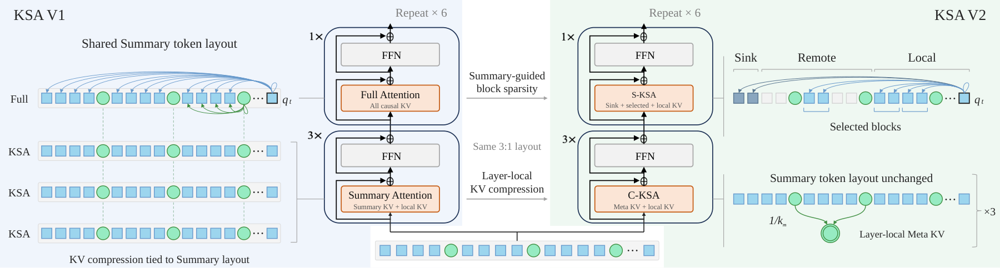
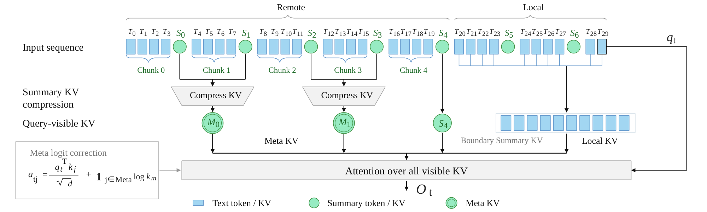
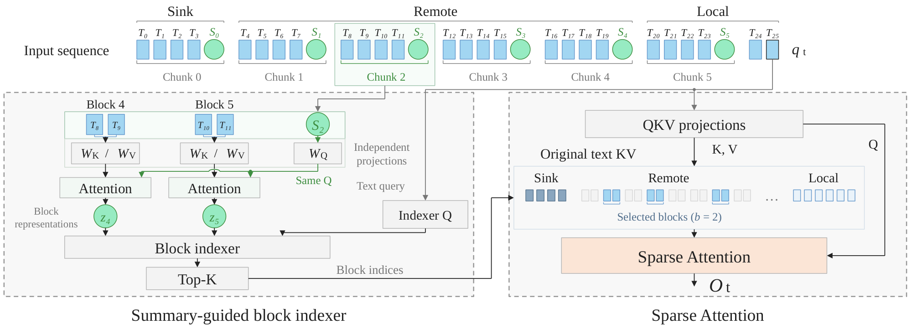
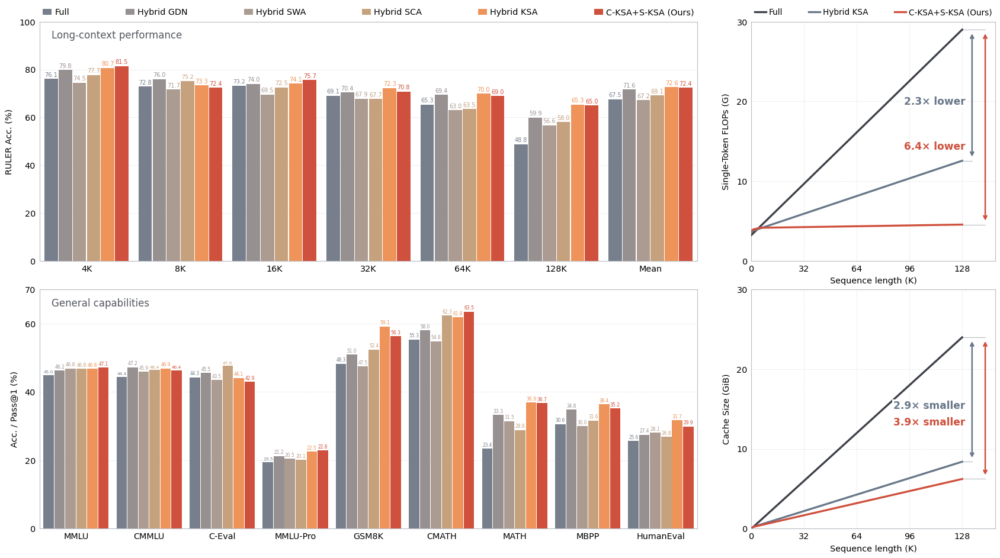

<div align="center">
  <h1>Kwai Summary Attention (KSA)</h1>
  <p><strong>用 Summary 同时构建长程记忆与稀疏索引</strong></p>
  <p>
    <a href="https://arxiv.org/abs/2610.18654"></a>
    <a href="https://arxiv.org/abs/2604.24432"></a>
    <a href="https://github.com/Kuaishou-OneRec/KSA"></a>
    <a href="LICENSE"></a>
  </p>
  <p><a href="README.md">English</a> | <a href="README_zh.md">中文</a></p>
</div>

## 📖 简介

**Kwai Summary Attention（KSA）** 是我们面向长上下文建模的高效注意力机制。
KSA 在固定 chunk 边界插入可学习的 Summary Token，以压缩后的状态保留对远端历史的访问。

**KSA V2** 进一步让 Summary 承担两个角色：

- **Compressed KSA（C-KSA）**：将多份 Summary KV 聚合为 Meta KV，进一步降低长程记忆的存储开销。
- **Sparse KSA（S-KSA）**：以 Summary 聚合原文块的选路表示，用轻量 Indexer 选择相关块，直接读取这些块的原始 KV。

我们保留 Hybrid KSA 的 3:1 层间布局，将 KSA 层替换为 C-KSA、Full 层替换为 S-KSA，
分别优化长程记忆和原文读取。本仓库提供两个版本的 **Muse 训练代码、注意力内核、
训练脚本、Hugging Face 导出与推理实现**。

<p align="center"></p>
<p align="center"><em>从 Hybrid KSA 到 KSA V2：复用 Summary，在注意力层内压缩 KV，并稀疏读取原文。</em></p>

## 🔥 新闻

- **2026-11-04** —— KSA V2 1.9B / 4B 与 KSA V1 1.9B 权重发布，见 [Hugging Face 模型合集](https://huggingface.co/collections/OpenOneRec/ksa)。
- **2026-10-13** —— [KSA V2 技术报告](https://arxiv.org/abs/2610.18654)发布。
- **2026-05-08** —— [KSA-4B-base](https://huggingface.co/OpenOneRec/KSA-4B-base) 权重发布。
- **2026-04-28** —— [KSA 技术报告](https://arxiv.org/abs/2604.24432)与训练代码发布。

## ✨ 方法与训练

**C-KSA：Summary → Meta KV。** 在注意力层内进行可学习的逐维聚合。
每组 Summary 生成一份更紧凑的 Meta KV；Summary Token 本身仍按原 chunk 粒度传递，
不必为增加压缩率重新训练更大 chunk 的主干。查询同时访问远程 Meta、边界 Summary
和局部原文 KV；Meta 仅在当前层内使用，不作为新 token 传递。

<p align="center"></p>
<p align="center"><em>C-KSA 两级压缩示意，图中 chunk 大小为 4，每 2 个 Summary 聚合为一个 Meta。</em></p>

**S-KSA：Summary → 块级索引。** 以 Summary 为 query 聚合原文块，再映射到低维索引空间。
主注意力读取选中块的原始 KV，并保留 sink 与局部窗口。Indexer 用按块取 max 的
dense attention teacher 监督训练。

<p align="center"></p>
<p align="center"><em>S-KSA 块级选路示意，图中 chunk 大小为 4、block 大小为 2；发布模型的实际配置见下表。</em></p>

**三个适配阶段。** 压缩模块 warmup → C-KSA 全参数 CPT → S-KSA 聚合模块与 Indexer warmup。
最后一阶段冻结继承参数，完成后直接导出用于稀疏推理。

V2 配置与使用方式见[训练说明](examples/ksa_v2/README.md)；KSA 的原始方法和结果保留在
[KSA V1](docs/ksa_v1_zh.md)。

## 🤖 Model Zoo

| 模型 | 主干 | 上下文 | 配置 | 权重 |
| --- | --- | --- | --- | --- |
| KSA-1.9B-base | 1.9B，MHA | 128K | Hybrid KSA，chunk8 | [Hugging Face](https://huggingface.co/OpenOneRec/KSA-1.9B-base) |
| KSA-4B-base | Qwen3-4B，GQA | 128K | Hybrid KSA，chunk8 | [Hugging Face](https://huggingface.co/OpenOneRec/KSA-4B-base) |
| KSA-V2-1.9B-base | 1.9B，MHA | 128K | chunk8，C-KSA group128，S-KSA block4 | [Hugging Face](https://huggingface.co/OpenOneRec/KSA-V2-1.9B-base) |
| KSA-V2-4B-base | 4B，GQA | 128K | chunk8，C-KSA group32，S-KSA block4 | [Hugging Face](https://huggingface.co/OpenOneRec/KSA-V2-4B-base) |

训练示例提供 1.9B 的完整适配流程。

### 发布模型配置

| 配置项 | KSA-v2-1.9B | KSA-v2-4B |
| :--- | :--- | :--- |
| 层数 | 24 | 36 |
| Hidden size | 2048 | 2560 |
| Intermediate size | 6144 | 9728 |
| Attention heads（Q / KV） | 16 / 16（MHA） | 32 / 8（GQA） |
| Head dimension | 128 | 128 |
| Hybrid 比例（C-KSA : S-KSA） | 3 : 1 | 3 : 1 |
| 最大上下文（原文 token） | 131072 | 131072 |
| Summary chunk size | 8 | 8 |
| C-KSA sliding chunk number | 128 | 128 |
| C-KSA group size | 128 | 32 |
| S-KSA block size | 4 | 4 |
| S-KSA 远程 token 预算 | 4096 | 4096 |
| Sink tokens | 8 | 8 |
| S-KSA 局部窗口（原文 token） | 1024 | 1024 |
| Indexer heads × head dimension | 8 × 128 | 8 × 128 |
| Indexer query rank | 512 | 512 |
| Indexer RoPE dimension | 64 | 64 |
| Indexer Q/K RMSNorm | False | True |
| Teacher 聚合 | max | max |
| Tied embeddings | False | True |

远程预算包含 8 个 sink token，局部窗口另计。

## 📈 实验结果

<p align="center"></p>
<p align="center"><em>1.9B 主结果：长上下文与通用能力（左），单 token 推理 FLOPs 与 KV cache 大小的理论值（右）。</em></p>

我们在两种 Hybrid KSA 主干上验证 KSA V2：从零训练的 1.9B，以及基于 Qwen3-4B
继续预训练的 4B。两者均经过三阶段适配，原始 baseline 结果沿用 KSA V1。

### 1.9B：长上下文检索

C-KSA 使用 group128，S-KSA 使用 block4；Hybrid KSA 是适配前的父模型。

| 模型 | 4K | 8K | 16K | 32K | 64K | 128K | Mean |
| --- | ---: | ---: | ---: | ---: | ---: | ---: | ---: |
| Full | 76.08 | 72.85 | 73.24 | 69.06 | 65.32 | 48.75 | 67.55 |
| Hybrid SWA | 74.54 | 71.69 | 69.54 | 67.86 | 63.03 | 56.64 | 67.22 |
| Hybrid SCA | 77.72 | 75.22 | 72.55 | 67.74 | 63.54 | 58.01 | 69.13 |
| Hybrid GDN | 79.83 | 76.01 | 74.04 | 70.41 | 69.39 | 59.87 | 71.59 |
| Pure KSA | 70.44 | 65.91 | 66.74 | 62.54 | 57.13 | 39.29 | 60.34 |
| Hybrid KSA | 80.65 | 73.35 | 74.07 | 72.30 | 69.95 | 65.35 | 72.61 |
| C-KSA + Full | 81.52 | 72.24 | 74.44 | 71.93 | 69.61 | 66.31 | 72.68 |
| **C-KSA + S-KSA** | 81.48 | 72.42 | 75.67 | 70.78 | 68.99 | 65.01 | 72.39 |

### 4B：扩展到 GQA 主干

C-KSA 使用 group32，S-KSA 使用 block4，保留主干的 GQA 结构。

| 模型 | 4K | 8K | 16K | 32K | 64K | 128K | Mean |
| --- | ---: | ---: | ---: | ---: | ---: | ---: | ---: |
| Full | 92.88 | 91.38 | 89.12 | 84.74 | 78.16 | 65.86 | 83.69 |
| Hybrid SWA | 91.30 | 88.03 | 82.87 | 78.94 | 73.88 | 66.27 | 80.22 |
| Hybrid SCA | 86.02 | 84.28 | 80.67 | 76.89 | 68.88 | 60.94 | 76.28 |
| Hybrid Linear | 86.39 | 83.86 | 78.06 | 76.48 | 73.50 | 67.98 | 77.71 |
| Pure KSA | 91.55 | 86.78 | 84.78 | 80.30 | 76.09 | 66.81 | 81.05 |
| Hybrid KSA | 92.97 | 90.53 | 88.86 | 86.65 | 76.04 | 71.67 | 84.45 |
| Hybrid KSA + CPT | 92.22 | 89.85 | 87.20 | 83.09 | 74.74 | 72.03 | 83.19 |
| C-KSA + Full | 92.77 | 88.12 | 86.27 | 82.68 | 78.58 | 73.92 | 83.72 |
| **C-KSA + S-KSA** | 93.38 | 87.78 | 85.45 | 83.60 | 80.28 | 74.41 | 84.15 |

Hybrid KSA + CPT 是不改模型结构的续训对照。

更多消融实验和推理效率分析见技术报告。少量示例数据只用于跑通流程，不用于复现上述分数。

## 🚀 快速开始

### 1. 安装 V2 环境

Linux、Python 3.12、CUDA 12.6、H100/H800。以下命令均从仓库根目录执行：

```bash
python3.12 -m venv .venv
source .venv/bin/activate
bash examples/ksa_v2/scripts/install.sh
```

### 2. 训练

每个阶段一个 shell，直接启动 `recipes/ksa_v2.py`。
先修改脚本顶部的 checkpoint、数据和输出路径；多机时在各节点设置
`NNODES`、`GPUS_PER_NODE`、`NODE_RANK`、`MASTER_ADDR`。
将 [KSA-1.9B-base](https://huggingface.co/OpenOneRec/KSA-1.9B-base)
下载到 `models/KSA-v1-1.9B`，或在压缩 warmup
时通过 `MODEL_DIR` 指定本地目录。

```bash
bash examples/ksa_v2/scripts/compress_warmup.sh
bash examples/ksa_v2/scripts/full_cpt.sh
bash examples/ksa_v2/scripts/indexer_warmup.sh
```

默认对应论文的 1600 / 800 / 4400 步，GBS32、128K。各阶段单独启动。
数据直接复用仓库中的 mmap 示例；压缩 warmup 默认直接加载 HF 权重，
后续阶段使用上一阶段生成的训练 checkpoint。
训练数据、短测、恢复训练与父模型选择见[训练说明](examples/ksa_v2/README.md)。

### 3. 导出与推理

```bash
python examples/ksa_v2/tools/export_hf.py \
  --checkpoint output/ksa_v2/indexer/global_step6800 \
  --model-config output/ksa_v2/indexer/model_config.json \
  --output-dir output/ksa_v2/hf

python output/ksa_v2/hf/generate.py \
  --prompt "The main idea of long-context modeling is" \
  --max-new-tokens 64
```

导出目录包含模型、tokenizer、运行时及内核，可以脱离训练仓库使用。
统一使用 infra 优化的推理实现，同时支持中间 C-KSA + Full 和最终 C-KSA + S-KSA 模型。

KSA V1 的渐进式预训练与导出仍见 [V1 训练说明](examples/ksa_v1/pretrain/README.md)；
V1 与 V2 的依赖环境分别维护。

## 📁 仓库结构

```text
muse/                       共享训练框架与模型
recipes/                    KSA V1 / V2 训练入口
examples/ksa_v1/             V1 预训练、导出与推理
examples/ksa_v2/             V2 三阶段适配、配置、导出与推理
summary_attention_kernel/   KSA / C-KSA / S-KSA 共用的 ksa_attn 内核
data/                       少量已分词训练样本
docs/                       KSA V1 方法与结果说明
```

## 📜 引用

```bibtex
@techreport{kwai2026ksav2,
  title       = {Kwai Summary Attention V2 Technical Report},
  author      = {OneRec Team},
  year        = {2026},
  institution = {Kuaishou Technology},
  url         = {https://arxiv.org/abs/2610.18654}
}

@techreport{kwai2026ksa,
  title       = {Kwai Summary Attention Technical Report},
  author      = {OneRec Team},
  year        = {2026},
  institution = {Kuaishou Technology},
  url         = {https://arxiv.org/abs/2604.24432}
}
```

## 🛡️ 许可证

代码采用 [Apache-2.0](LICENSE)，权重与数据遵循各自的许可证。

## 🙏 致谢

感谢 Qwen、FlashAttention、Hugging Face、PyTorch 和 torchtune：
Qwen 派生运行时保留 Apache-2.0 声明，共享 tokenizer 来自 KSA V1 使用的 Qwen tokenizer；
torchtune 派生代码遵循 [BSD-3-Clause](licenses/torchtune-LICENSE)；
所带 FlashAttention CuTe 源码和 wheel 保留其 BSD-3-Clause LICENSE 与 AUTHORS。
